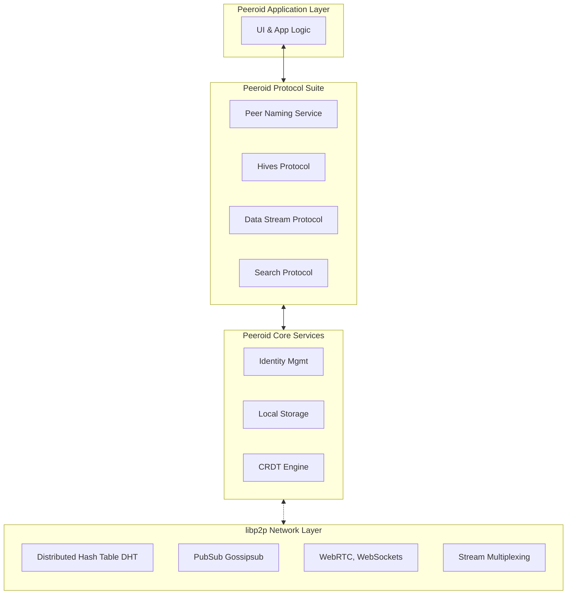

# **The Peeroid Protocol Specification**
**Version:** 0.1 (Initial Draft)
**Status:** Work in Progress / Pre-Alpha
**Date:** 2026-01-11
**Abstract:** This document specifies the Peeroid Protocol, a modular application-layer protocol suite for building fully decentralized communication, data sharing, and hypermedia platforms. It provides a framework for identity, peer discovery, human-readable naming, group collaboration (Hives), and data sovereignty, all built atop libp2p for foundational peer-to-peer networking.

---

## **1. Introduction**

### **1.1. Purpose & Philosophy**
The Peeroid Protocol is designed to enable the creation of applications where users retain full ownership and control of their data, communications, and social graphs. It challenges the client-server paradigm by distributing all application state, logic, and storage across users' devices ("peers"). The protocol's goal is to be a universal, language-agnostic standard for building censorship-resistant, privacy-enhancing, and user-sovereign software.

### **1.2. Design Principles**
*   **Strict Decentralization:** No central servers for data, identity, or control logic. The network is its users.
*   **User Sovereignty:** Cryptographic keys and personal data reside solely on the user's device. The protocol provides tools for ownership and permission management.
*   **Modularity & Extensibility:** The protocol is a suite of independent modules. Implementations can support only the modules they need, and new modules can be added without breaking existing ones.
*   **Offline-First & Eventual Consistency:** Peers can work fully offline. Data synchronizes when connections are available, converging to a consistent state using conflict-free replicated data types (CRDTs).
*   **Protocol over Platform:** The specification is open, enabling multiple independent and interoperable applications to participate in the same network.

### **1.3. Core Architectural Overview**
The Peeroid Protocol is an **application-layer suite** built on top of **libp2p**, which handles the lower-layer complexities of transport, secure channel establishment, peer discovery, and routing. Peeroid defines the *what* and *why* of communication, while libp2p handles the *how* and *where*.



## **2. Foundational Layer: Network & Identity**

### **2.1. Network Primitives (libp2p)**
Peeroid delegates all network-layer concerns to libp2p, a modular networking stack. Key libp2p components used are:
*   **Transports:** `WebRTC` (primary for browser-to-browser), `WebSockets` (fallback).
*   **Secure Channels:** `Noise` protocol for encrypted connections.
*   **Peer Discovery:** `kadDHT` (Kademlia Distributed Hash Table) for finding peers and information in the network.
*   **Group Communication:** `gossipsub` (PubSub) for efficient many-to-many messaging within Hives.
*   **Protocol Multiplexing:** Ability to run multiple application protocols (e.g., `/peeroid/hive/1.0.0`, `/peeroid/data/1.0.0`) over a single connection.

### **2.2. Peer Identity System**
Every participant in the network is a **Peer**, identified by a **libp2p Peer ID**, derived from a public key. Peeroid implements a dual identity model:

| Identity Type | Generation | Persistence | Use Case |
| :--- | :--- | :--- | :--- |
| **Ephemeral** | New key-pair on each session start. Not saved. | None. All local state purged on exit. | Temporary, anonymous sessions. "Incognito mode." |
| **Permanent** | Key-pair generated once, encrypted and stored locally. | Local secure vault (e.g., IndexedDB). | Primary user identity, persistent profile, data ownership. |

This model aligns with the concept of **Peer DIDs**, which are perfect for private, pairwise, or n-wise relationships without needing a central ledger. A Peeroid Permanent Identity is functionally equivalent to a `did:peer`.

### **2.3. Peer Discovery**
Peers find each other through the libp2p DHT. The process for a new peer is:
1.  Connect to one or more **hard-coded bootstrap nodes** (simple libp2p peers with public addresses).
2.  Query the DHT to find peers interested in specific topics or Hives.
3.  Advertise its own presence and capabilities on the DHT.
4.  Form direct connections with discovered peers. The bootstrap nodes are then no longer necessary for that peer's connectivity.

## **3. Core Protocol Suite**

### **3.1. Peer Naming Service (PNS)**
PNS provides a human-readable naming layer atop cryptographic Peer IDs, similar to DNS.

*   **Name Format:** `name@peeroid` or `peeroid://name`
*   **Registration:** To prevent name hoarding, registration requires a **Proof-of-Work (PoW)**. The claimant must solve a moderately difficult computational puzzle (e.g., find a hash with leading zeros) for the desired name. This imposes a real-world cost (CPU time), making large-scale hoarding economically impractical.
*   **Ownership Record:** A signed record mapping `name -> Peer ID` is published to the DHT.
*   **Transfer & Renewal:** Ownership can be transferred via a signed transaction published to the DHT. Names are leased (e.g., for 1 year) and require a new PoW to renew.

### **3.2. Hives: Decentralized Groups**
A Hive is a sub-network for collaborative interaction. It is defined by a unique **Hive ID** (the hash of its founding document).

| Characteristic       | Description                                                                                                                                                                 |
| :------------------- | :-------------------------------------------------------------------------------------------------------------------------------------------------------------------------- |
| **Type**             | **Public:** Discoverable via DHT. **Private:** Requires invite (a signed token).                                                                                            |
| **State Management** | All shared state (member list, roles, chat history, pinned files) is a **CRDT** replicated among all members. This guarantees eventual consistency even with offline edits. |
| **Communication**    | Real-time chat uses `gossipsub` on a Hive-specific topic. Administrative actions (add/remove member) are operations on the membership CRDT.                                 |
| **Permission Model** | A Capability-based Access Control CRDT manages roles (Admin, Member, Guest) and their permissions (read, write, invite, etc.).                                              |
| **Addressing**       | `hive://hive-name` or via its Hive ID. Names are scoped separately from PNS.                                                                                                |

### **3.3. Direct Data Stream Protocol**
A general-purpose protocol for reliable, bidirectional data transfer between two peers.
*   **Protocol ID:** `/peeroid/data/1.0.0`
*   **Purpose:** File transfers, screen sharing, video/audio streaming.
*   **Mechanism:** Once peers are connected via libp2p, one peer opens a new **libp2p stream** using this protocol ID. Data is chunked, sequentially delivered, and integrity-checked.

### **3.4. Hypermedia Distribution System**
A content-addressed system for sharing immutable resources (documents, images, videos).
*   **Content Identifier (CID):** Each resource is hashed, producing a unique CID (e.g., using IPLD conventions). The CID is its permanent, immutable link.
*   **Distribution:** The resource is split into chunks. Peers possessing the chunks advertise their availability on the DHT. A requesting peer discovers these providers via the DHT and fetches chunks directly from them using the Data Stream Protocol.
*   **Link Format:** `hyper://{CID}`

### **3.5. Distributed Search Protocol**
A privacy-preserving, decentralized search mechanism.
*   **Mechanism:** Peers can optionally **index public metadata** from Hives they are members of (titles, descriptions, public hypermedia CIDs and metadata, *not private content*).
*   **Query Process:** A search query is flooded through the `gossipsub` network to a limited "hop" radius. Peers with relevant indexed metadata respond directly to the querier with results.
*   **Model:** This creates a **distributed, peer-powered index**, avoiding a central search engine. Results are ranked locally by the querying client.

## **4. Data Model & Security**

### **4.1. Data Ownership & Permissions**
Every piece of mutable data (a post, a wiki page) has:
1.  **Creator Signature:** Cryptographically signed by its creator's private key, proving provenance.
2.  **Permission Manifest:** A small, signed data structure (stored in the DHT alongside the data's CID) that defines access control lists (ACLs) – which Peer IDs or Hives have read, write, or admin permissions.

### **4.2. End-to-End Encryption (E2EE)**
*   **Direct Messaging:** Encrypted with the recipient's public key.
*   **Hive Communication:** Uses **Pairwise E2EE**. Each member shares a unique symmetric key with every other member. A message is encrypted once for each member. This preserves privacy even within the group.
*   **Hypermedia:** Can be encrypted symmetrically, with the key shared via E2EE channels with authorized peers.

### **4.3. Conflict Resolution with CRDTs**
Hive state (like chat logs or collaborative documents) is built using **Operation-based CRDTs**. Every edit (e.g., "insert character 'A' at position 5") is a self-contained operation that can be applied in any order. As long as all peers eventually receive all operations, they will converge to the exact same final state, resolving any conflicts automatically.

## **5. Protocol Specification Details**

### **5.1. Protocol IDs & Modularity**
Each Peeroid module is identified by a unique libp2p Protocol ID string. A peer announces the protocols it supports via libp2p's `identify` protocol.

| Module | Protocol ID | Description |
| :--- | :--- | :--- |
| **Core Presence** | `/peeroid/presence/1.0.0` | Advertise supported modules & basic peer info. |
| **Naming (PNS)** | `/peeroid/pns/1.0.0` | Register, resolve, and transfer names. |
| **Hive Membership** | `/peeroid/hive/membership/1.0.0` | Join, leave, modify member list/roles (CRDT sync). |
| **Hive Messaging** | `/peeroid/hive/chat/1.0.0` | Real-time text communication (over gossipsub). |
| **Data Stream** | `/peeroid/data/1.0.0` | Open a direct, reliable data stream. |
| **Search** | `/peeroid/search/1.0.0` | Propagate queries and receive results. |

### **5.2. Message Formats & Serialization**
All protocol messages are serialized using a compact, language-neutral format (e.g., Protocol Buffers, CBOR). The specification for each Protocol ID will define its specific message types (Request/Response, Event).

**Example (Conceptual) - PNS Registration Message:**
```protobuf
message PNSRegistration {
  string requested_name = 1;
  bytes registrant_peer_id = 2;
  uint64 timestamp = 3;
  bytes proof_of_work_nonce = 4; // Solution to the PoW puzzle
  bytes signature = 5; // Signed by registrant_peer_id's private key
}
```

## **6. Implementation Considerations**

### **6.1. Bootstrapping & Network Growth**
*   **Initial Bootstrapping:** Requires a small, hard-coded list of stable libp2p bootstrap nodes.
*   **Growth & Health:** As the network grows, community-run nodes can supplement the initial list. Network health depends on a sufficient density of online peers hosting DHT data and replicating hive content.

### **6.2. Resource Management & Incentives**
*   **Challenge:** Storing and serving data for others (hypermedia chunks, hive history) consumes resources with no inherent reward.
*   **Mitigation Strategies:**
    *   **Social/Voluntary:** Peers in a Hive are expected to store data for that Hive.
    *   **Reciprocal:** Clients may prioritize serving data to peers that also serve data.
    *   **Future Exploration:** Protocol extensions for micro-incentives or resource credits.

## **7. Appendices**

### **7.1. Glossary**
*   **CID (Content Identifier):** A self-describing, hash-based permanent identifier for immutable data.
*   **CRDT (Conflict-free Replicated Data Type):** A data structure that can be replicated across multiple peers, updated concurrently without coordination, and will deterministically converge to the same state.
*   **DHT (Distributed Hash Table):** A decentralized key-value storage layer spread across all participating peers, used for discovery.
*   **Hive:** A decentralized group with shared state and communications.
*   **libp2p:** A modular network stack for peer-to-peer applications.
*   **Peer:** An instance of software implementing the Peeroid Protocol.
*   **Peer ID:** A libp2p cryptographic identifier for a peer.
*   **PNS (Peer Naming Service):** The human-readable naming system for peers.
*   **Proof-of-Work (PoW):** A cryptographic mechanism requiring demonstrable computational effort to deter spam and sybil attacks.

---
*This specification is a living document and will evolve through community input and implementation feedback. Implementers are encouraged to join the discussion to shape future versions.*

PS: I have absolutely no Idea what I am doing, I try to learn as I go.